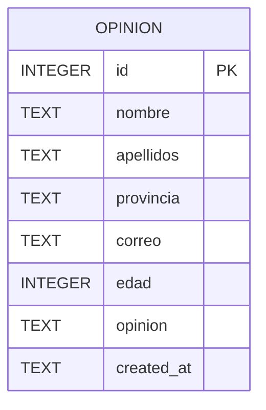

# Modelo entidad-relación

La aplicación guarda las opiniones enviadas desde el formulario. La entidad `Opinión` representa un envío válido y conserva únicamente los datos necesarios para atender la práctica.

No se modela la navegación de planetas como datos de usuario: son contenido editorial estático y no requieren persistencia.

